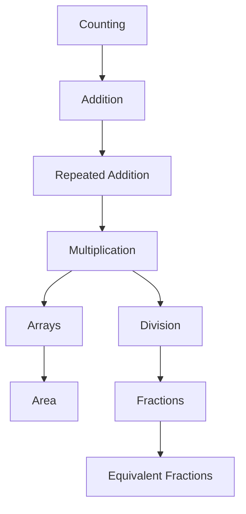
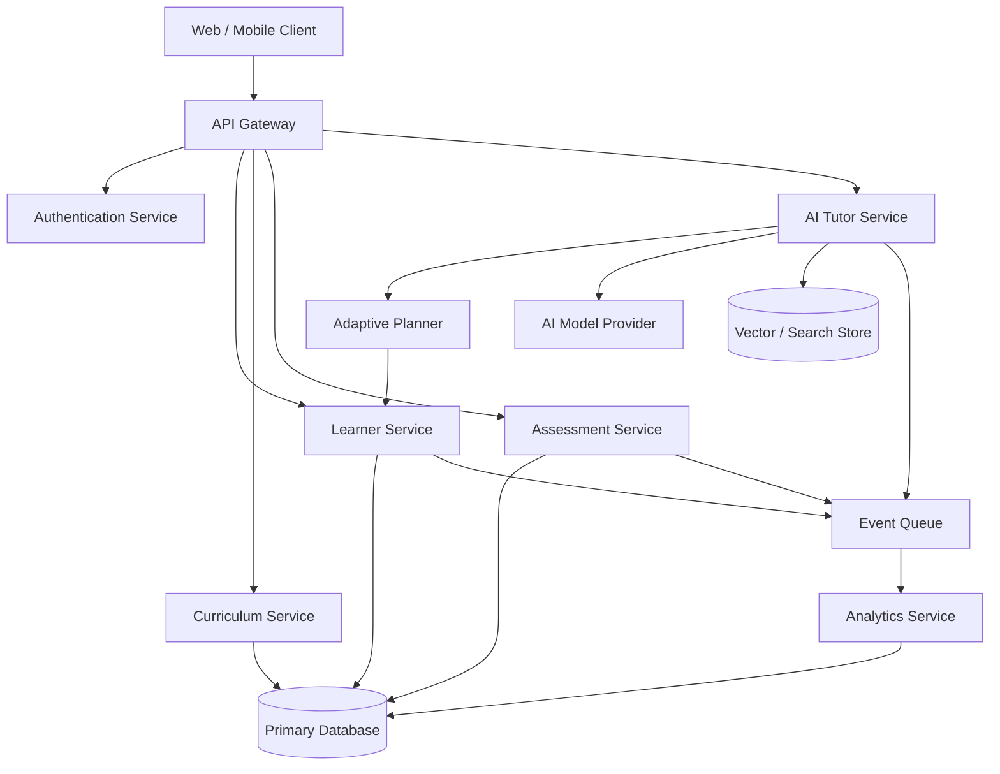
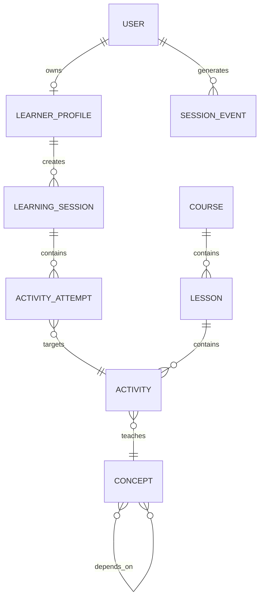
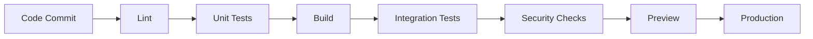
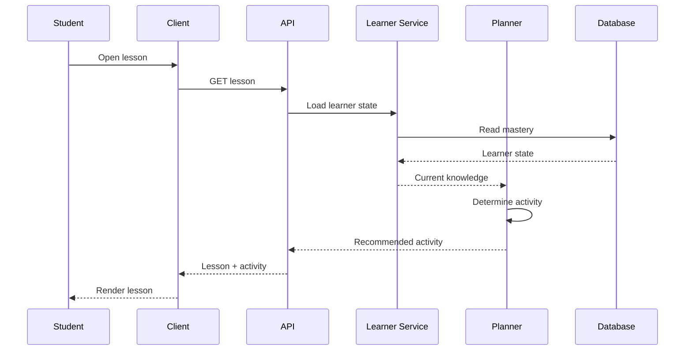
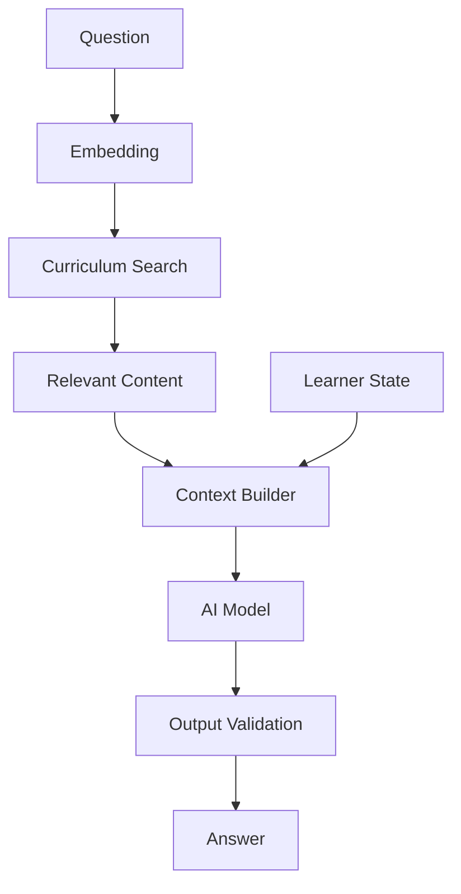
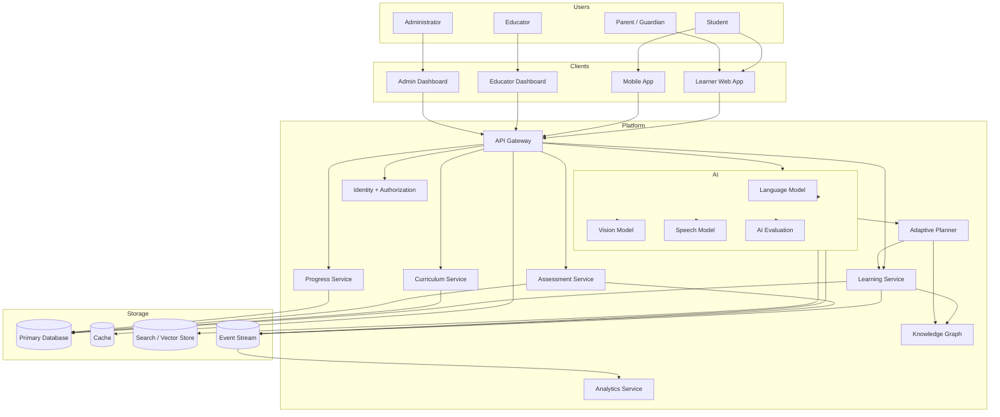
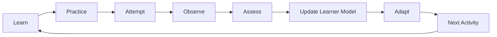
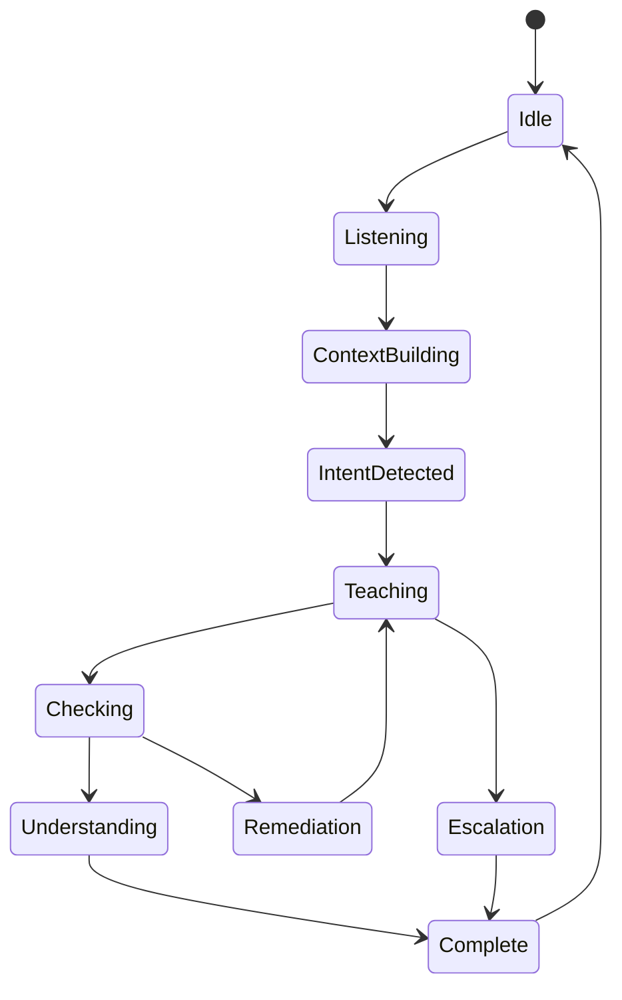
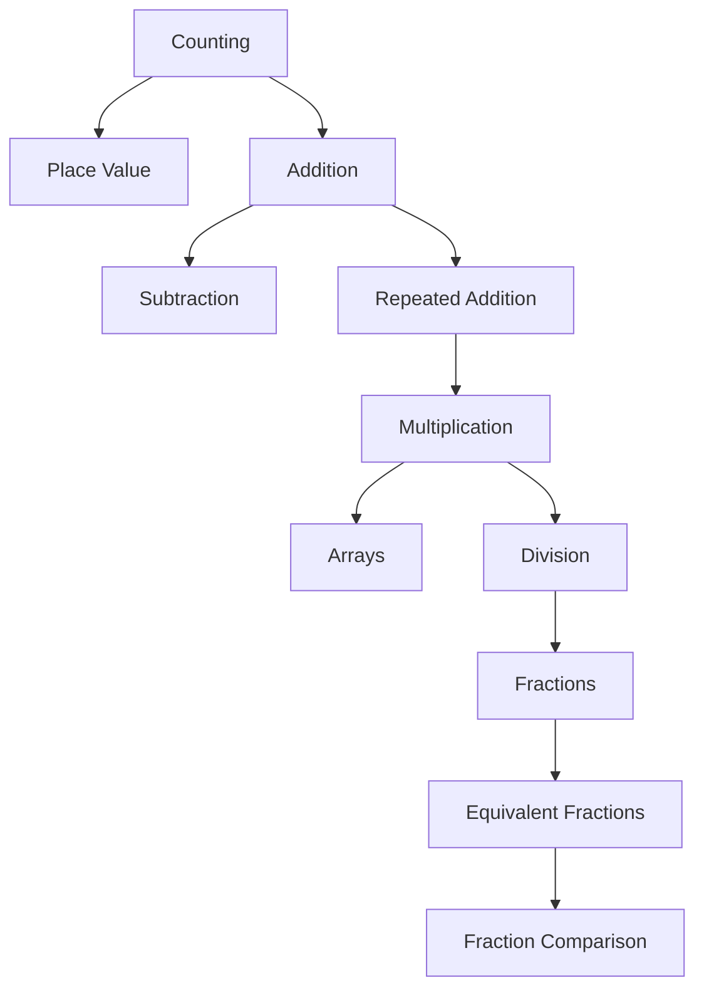

# 🧠 Primer AI Educational 

> **An AI-powered educational platform designed to turn learning into an interactive, personalized, measurable experience.**


[](#)
[](#)
[](#)
[](#)
[](#)

---

## Table of Contents

* [1. Overview](#1-overview)
* [2. Vision](#2-vision)
* [3. Problem](#3-problem)
* [4. Solution](#4-solution)
* [5. Core Product Principles](#5-core-product-principles)
* [6. Core Features](#6-core-features)
* [7. User Experience](#7-user-experience)
* [8. AI Learning Engine](#8-ai-learning-engine)
* [9. Adaptive Learning](#9-adaptive-learning)
* [10. Curriculum Architecture](#10-curriculum-architecture)
* [11. Lesson Architecture](#11-lesson-architecture)
* [12. Assessment Engine](#12-assessment-engine)
* [13. Knowledge Graph](#13-knowledge-graph)
* [14. Student Profile](#14-student-profile)
* [15. AI Tutor](#15-ai-tutor)
* [16. Multimodal Learning](#16-multimodal-learning)
* [17. Safety and Responsible AI](#17-safety-and-responsible-ai)
* [18. Privacy Architecture](#18-privacy-architecture)
* [19. Backend Architecture](#19-backend-architecture)
* [20. Frontend Architecture](#20-frontend-architecture)
* [21. Data Architecture](#21-data-architecture)
* [22. API Architecture](#22-api-architecture)
* [23. Authentication](#23-authentication)
* [24. Offline and Resilient Experiences](#24-offline-and-resilient-experiences)
* [25. Analytics](#25-analytics)
* [26. AI Evaluation](#26-ai-evaluation)
* [27. Testing](#27-testing)
* [28. Performance](#28-performance)
* [29. Accessibility](#29-accessibility)
* [30. Security](#30-security)
* [31. Observability](#31-observability)
* [32. Deployment](#32-deployment)
* [33. CI/CD](#33-cicd)
* [34. Developer Setup](#34-developer-setup)
* [35. Environment Variables](#35-environment-variables)
* [36. Example API Flows](#36-example-api-flows)
* [37. Example Data Models](#37-example-data-models)
* [38. Example AI Pipelines](#38-example-ai-pipelines)
* [39. Design System](#39-design-system)
* [40. Gamification](#40-gamification)
* [41. Parent and Educator Experience](#41-parent-and-educator-experience)
* [42. Content Management](#42-content-management)
* [43. Monetization](#43-monetization)
* [44. Scalability](#44-scalability)
* [45. Disaster Recovery](#45-disaster-recovery)
* [46. Roadmap](#46-roadmap)
* [47. Recommended Repository Structure](#47-recommended-repository-structure)
* [48. Contributing](#48-contributing)
* [49. Troubleshooting](#49-troubleshooting)
* [50. Demo Narrative](#50-demo-narrative)
* [51. Product Differentiation](#51-product-differentiation)
* [52. Future AI Capabilities](#52-future-ai-capabilities)
* [53. Technical Decision Records](#53-technical-decision-records)
* [54. Launch Checklist](#54-launch-checklist)
* [55. Conclusion](#55-conclusion)

---

# 1. Overview

**Primer AI Educational — Coppard Ave** is an AI-powered learning platform designed to make education more adaptive, interactive, measurable, and accessible.

Traditional educational software commonly assumes that every student should move through the same material at approximately the same speed.

Primer takes a different architectural approach.

Instead of treating learning as a fixed sequence:

```text
Lesson
   ↓
Quiz
   ↓
Score
   ↓
Next Lesson
```

Primer can model learning as a continuous feedback loop:

```text
                    ┌─────────────────────┐
                    │      LEARNER        │
                    └──────────┬──────────┘
                               │
                               ▼
                    ┌─────────────────────┐
                    │  LEARNING ACTIVITY  │
                    └──────────┬──────────┘
                               │
                               ▼
                    ┌─────────────────────┐
                    │   AI OBSERVATIONS   │
                    └──────────┬──────────┘
                               │
                               ▼
                    ┌─────────────────────┐
                    │ LEARNER MODEL       │
                    │ + KNOWLEDGE GRAPH   │
                    └──────────┬──────────┘
                               │
                               ▼
                    ┌─────────────────────┐
                    │ ADAPTIVE PLANNER    │
                    └──────────┬──────────┘
                               │
                               ▼
                    ┌─────────────────────┐
                    │ NEXT BEST ACTIVITY  │
                    └──────────┬──────────┘
                               │
                               └───────────────►
                                      Learner
```

The objective is not simply to provide answers.

The objective is to help the learner understand **why** an answer works, identify misconceptions, practice deliberately, and progressively become more independent.

---

# 2. Vision

## The Vision

Primer is designed around a simple idea:

> **AI should help students learn how to think, not merely tell them what to think.**

The platform therefore combines:

* AI tutoring
* adaptive learning
* structured curriculum
* interactive lessons
* formative assessment
* learner profiles
* knowledge graphs
* multimodal input
* progress tracking
* educator tools
* parent visibility
* responsible AI controls
* privacy-aware data handling

The long-term architecture is intended to support multiple subjects, age groups, learning styles, and delivery environments without rebuilding the platform for every course.

---

# 3. Problem

Educational experiences face several structural problems.

## 3.1 One-size-fits-all pacing

A classroom may contain students with significantly different levels of prior knowledge.

One student may already understand multiplication.

Another may still need concrete visual examples.

A fixed curriculum cannot always adapt quickly enough.

---

## 3.2 Feedback arrives too late

Traditional assessment can create a delay:

```text
Student Work
     ↓
Assignment Submitted
     ↓
Teacher Review
     ↓
Grade
     ↓
Feedback
     ↓
Student Revisits Concept
```

Primer can shorten that feedback loop:

```text
Student Interaction
        ↓
Immediate Observation
        ↓
Misconception Detection
        ↓
Targeted Explanation
        ↓
Practice
        ↓
Reassessment
```

---

## 3.3 Students may memorize procedures without understanding

A correct answer does not necessarily demonstrate conceptual mastery.

For example:

```text
2 × 4 = 8
```

does not automatically prove that the learner understands:

* repeated addition
* groups
* arrays
* number relationships
* multiplication properties

Primer therefore treats the answer as one signal rather than the entire learning state.

---

## 3.4 Learning context matters

A learner may:

* understand an idea verbally
* struggle with a visual representation
* solve a familiar exercise
* struggle when the numbers change
* remember a fact
* fail to apply it in a new context

Primer's architecture therefore supports multiple evidence types.

---

# 4. Solution

Primer combines educational content with AI-driven personalization.

At a high level:

```text
┌─────────────────────────────────────────────────────────┐
│                    PRIMER PLATFORM                      │
├─────────────────────────────────────────────────────────┤
│                                                         │
│  Content            AI                Learner Model      │
│  ────────           ────              ────────────      │
│  Lessons            Tutor             Skill State       │
│  Activities         Feedback          Mastery           │
│  Questions          Planning          Misconceptions    │
│  Explanations       Generation        Progress          │
│                                                         │
├─────────────────────────────────────────────────────────┤
│                                                         │
│                  EXPERIENCE LAYER                       │
│                                                         │
│       Student       Educator       Parent/Guardian      │
│                                                         │
└─────────────────────────────────────────────────────────┘
```

The platform is designed as a set of composable systems rather than one monolithic AI feature.

---

# 5. Core Product Principles

## 5.1 Understanding over answer generation

The system should optimize for learning outcomes rather than answer volume.

---

## 5.2 Adaptation over rigid sequencing

A lesson path should be adjustable based on demonstrated understanding.

---

## 5.3 Explainability over opaque scoring

Whenever possible, learners and educators should be able to understand why a recommendation occurred.

---

## 5.4 Human oversight

AI should support educators and learners rather than replace responsible human supervision.

---

## 5.5 Privacy by design

Student data should be collected intentionally and only to the degree required for the feature.

---

## 5.6 Accessibility first

The system should support:

* keyboard navigation
* screen readers
* readable contrast
* captions
* alternative interaction modes
* simplified language
* multimodal learning

---

# 6. Core Features

Primer can be organized into the following product modules.

| Module             | Purpose                                |
| ------------------ | -------------------------------------- |
| AI Tutor           | Conversational educational support     |
| Lessons            | Structured curriculum experiences      |
| Activities         | Interactive learning tasks             |
| Assessments        | Knowledge measurement                  |
| Learner Model      | Representation of student progress     |
| Knowledge Graph    | Relationships between concepts         |
| Adaptive Planner   | Determines appropriate next activities |
| Progress Dashboard | Shows learning trajectory              |
| Educator Console   | Curriculum and learner management      |
| Parent View        | High-level progress visibility         |
| AI Safety Layer    | Responsible AI controls                |
| Analytics          | Product and learning telemetry         |

---

# 7. User Experience

A typical learner session may look like this:

```text
LOGIN
  │
  ▼
HOME
  │
  ├──────────────► Continue Learning
  │
  ├──────────────► Explore Subject
  │
  ├──────────────► Practice
  │
  └──────────────► Ask AI Tutor
                         │
                         ▼
                  Learning Session
                         │
                         ▼
                  Evidence Collected
                         │
                         ▼
                   Skill Updated
                         │
                         ▼
               Next Activity Suggested
```

The learner should not have to understand the internal AI architecture.

The complexity should remain behind a simple interface.

---

# 8. AI Learning Engine

The AI learning engine is the central intelligence layer.

Rather than having a single:

```text
User Prompt → LLM → Answer
```

architecture, Primer should use a controlled pipeline.

```text
                   USER INPUT
                       │
                       ▼
              ┌─────────────────┐
              │ Input Validation │
              └────────┬────────┘
                       ▼
              ┌─────────────────┐
              │ Context Builder  │
              └────────┬────────┘
                       ▼
        ┌──────────────────────────────┐
        │ Learner Model + Lesson State │
        └──────────────┬───────────────┘
                       ▼
              ┌─────────────────┐
              │ Intent Router   │
              └────────┬────────┘
                       ▼
        ┌──────────────────────────────┐
        │ Pedagogical Policy Engine    │
        └──────────────┬───────────────┘
                       ▼
              ┌─────────────────┐
              │ AI Generation   │
              └────────┬────────┘
                       ▼
              ┌─────────────────┐
              │ Safety / QA     │
              └────────┬────────┘
                       ▼
                    RESPONSE
```

---

# 9. Adaptive Learning

Adaptive learning is the mechanism that allows Primer to vary the experience.

A learner state can be represented conceptually as:

```text
Concept
 ├── status
 ├── confidence
 ├── evidence
 ├── attempts
 ├── misconceptions
 ├── prerequisite state
 └── last assessed timestamp
```

Example:

```json
{
  "conceptId": "fractions.equivalent",
  "mastery": 0.68,
  "confidence": 0.61,
  "attempts": 7,
  "recentTrend": "improving",
  "misconceptions": [
    "denominator_comparison"
  ]
}
```

The adaptive planner can combine this state with curriculum requirements.

---

## Adaptive Decision Model

```text
                ┌───────────────┐
                │ Learner State │
                └───────┬───────┘
                        │
          ┌─────────────┼─────────────┐
          ▼             ▼             ▼
     Mastery       Confidence    Misconceptions
          │             │             │
          └─────────────┼─────────────┘
                        ▼
               ┌─────────────────┐
               │ Adaptive Policy │
               └────────┬────────┘
                        │
             ┌──────────┼──────────┐
             ▼          ▼          ▼
          Review      Practice   Challenge
```

The system does not have to force every learner through the same pathway.

---

# 10. Curriculum Architecture

Primer can represent curriculum as a hierarchy.

```text
Subject
   │
   ├── Unit
   │     │
   │     ├── Module
   │     │     │
   │     │     ├── Lesson
   │     │     │     ├── Concept
   │     │     │     ├── Example
   │     │     │     ├── Activity
   │     │     │     └── Assessment
   │     │
   │     └── Review
   │
   └── Capstone
```

Example:

```text
Mathematics
│
├── Number Sense
│   ├── Place Value
│   ├── Addition
│   ├── Subtraction
│   └── Number Relationships
│
├── Multiplication
│   ├── Groups
│   ├── Arrays
│   ├── Facts
│   └── Word Problems
│
└── Fractions
    ├── Parts of a Whole
    ├── Equivalence
    ├── Comparison
    └── Operations
```

This architecture can generalize to other subjects.

---

# 11. Lesson Architecture

A lesson should be more than text on a screen.

A lesson can contain:

```json
{
  "lessonId": "math-001",
  "title": "Understanding Arrays",
  "objectives": [
    "Understand arrays as repeated groups",
    "Represent multiplication visually"
  ],
  "prerequisites": [
    "counting",
    "addition"
  ],
  "activities": [
    "concept_intro",
    "interactive_array",
    "guided_practice",
    "independent_practice"
  ],
  "assessment": {
    "type": "formative",
    "questions": 5
  }
}
```

---

## Recommended Lesson Flow

```text
┌───────────────┐
│   Objective   │
└───────┬───────┘
        ▼
┌───────────────┐
│ Activate      │
│ Prior Memory  │
└───────┬───────┘
        ▼
┌───────────────┐
│ Explain       │
└───────┬───────┘
        ▼
┌───────────────┐
│ Demonstrate   │
└───────┬───────┘
        ▼
┌───────────────┐
│ Guided Practice│
└───────┬───────┘
        ▼
┌───────────────┐
│ Independent   │
│ Practice      │
└───────┬───────┘
        ▼
┌───────────────┐
│ Reflection    │
└───────┬───────┘
        ▼
┌───────────────┐
│ Reassessment  │
└───────────────┘
```

---

# 12. Assessment Engine

Primer should support multiple assessment styles.

## 12.1 Multiple choice

Useful for quick formative assessment.

## 12.2 Free response

Tests explanation and reasoning.

## 12.3 Ordering

Useful for sequencing and processes.

## 12.4 Matching

Useful for vocabulary and concept relationships.

## 12.5 Interactive manipulation

Useful for:

* arithmetic
* geometry
* science
* language
* diagrams

## 12.6 AI-mediated explanation

A student can explain:

> "Why do you think the answer is 24?"

The AI evaluates reasoning signals rather than only final values.

---

# 13. Knowledge Graph

A knowledge graph enables Primer to understand prerequisite relationships.



The graph can be represented as:

```text
Node = Concept

Edge = Relationship

Examples:

COUNTING
   ↓ prerequisite
ADDITION
   ↓ prerequisite
MULTIPLICATION

EQUIVALENT_FRACTIONS
   ↓ supports
FRACTION_COMPARISON
```

This becomes important for adaptive remediation.

If a student repeatedly struggles with multiplication, Primer can investigate prerequisite nodes rather than simply delivering more multiplication questions.

---

# 14. Student Profile

A learner profile should combine educational state with responsible personalization.

Example:

```json
{
  "studentId": "student_123",
  "gradeBand": "elementary",
  "subjects": {
    "math": {
      "mastery": 0.72,
      "activeGoals": [
        "multiplication",
        "fractions"
      ]
    }
  },
  "preferences": {
    "preferredActivityTypes": [
      "visual",
      "interactive"
    ]
  },
  "learningState": {
    "focusConcept": "multiplication.arrays",
    "confidence": 0.64
  }
}
```

The profile should be versioned rather than blindly overwritten.

---

# 15. AI Tutor

The AI tutor should behave differently from a general-purpose chatbot.

## Traditional chatbot

```text
QUESTION
   ↓
ANSWER
```

## Educational tutor

```text
QUESTION
   ↓
UNDERSTAND INTENT
   ↓
CHECK LEARNER CONTEXT
   ↓
DECIDE PEDAGOGICAL STRATEGY
   ↓
ASK / HINT / EXPLAIN
   ↓
CHECK UNDERSTANDING
   ↓
UPDATE LEARNING STATE
```

---

## Tutor Modes

### Socratic mode

Uses questions to help the learner reason.

### Hint mode

Provides a small clue.

### Explain mode

Provides a direct explanation.

### Example mode

Shows a worked example.

### Practice mode

Generates similar practice.

### Reflection mode

Asks the student to explain their own reasoning.

---

# 16. Multimodal Learning

A modern learning platform should not assume every interaction is typed text.

Potential input channels include:

```text
                 ┌──────────────┐
                 │   Learner    │
                 └──────┬───────┘
                        │
       ┌────────────────┼────────────────┐
       ▼                ▼                ▼
     Text             Voice             Image
       │                │                │
       └────────────────┼────────────────┘
                        ▼
               ┌─────────────────┐
               │ Multimodal      │
               │ Processing      │
               └────────┬────────┘
                        ▼
                  Tutor Context
```

Potential experiences include:

* spoken questions
* photographed homework
* diagram interpretation
* handwriting recognition
* pronunciation practice
* visual concept explanations

---

# 17. Safety and Responsible AI

Education involving young learners requires strong safety controls.

The AI layer should use multiple safety boundaries.

```text
USER INPUT
   │
   ▼
Input Filtering
   │
   ▼
Context Construction
   │
   ▼
Pedagogical Rules
   │
   ▼
Model Generation
   │
   ▼
Output Validation
   │
   ▼
Safe Response
```

---

## Safety Principles

Primer should:

* avoid inappropriate content
* avoid encouraging dangerous behavior
* protect sensitive information
* distinguish uncertainty from facts
* reduce hallucinated educational claims
* avoid pretending to be a human
* provide escalation pathways when necessary
* keep adult-facing controls distinct from learner experiences

For educational content, an AI answer should preferably be grounded in approved curriculum material when available.

---

# 18. Privacy Architecture

Student information should be treated as sensitive product data.

A conceptual privacy architecture:

```text
                 CLIENT
                   │
                   ▼
             API GATEWAY
                   │
          ┌────────┴────────┐
          ▼                 ▼
       Identity        Authorization
          │                 │
          └────────┬────────┘
                   ▼
             Application
                   │
          ┌────────┴─────────┐
          ▼                  ▼
    Learning Data       AI Gateway
          │                  │
          ▼                  ▼
       Database        Privacy Filters
```

Potential privacy controls:

* data minimization
* encryption in transit
* encryption at rest
* role-based access
* audit logging
* deletion workflows
* retention policies
* explicit consent where required
* separation of learner and administrative data

---

# 19. Backend Architecture

A scalable backend can be organized into modular services.



This architecture allows individual modules to evolve independently.

---

# 20. Frontend Architecture

A component-based frontend can separate:

```text
Presentation
     │
     ▼
Feature Modules
     │
     ▼
Application State
     │
     ▼
Service Layer
     │
     ▼
API
```

Recommended frontend categories:

```text
src/
├── components/
├── screens/
├── features/
├── hooks/
├── services/
├── state/
├── models/
├── utils/
├── navigation/
├── theme/
└── assets/
```

Feature-based architecture is useful when the application grows.

Example:

```text
features/
├── auth/
├── lessons/
├── tutor/
├── assessments/
├── progress/
├── profile/
├── educator/
└── settings/
```

---

# 21. Data Architecture

The platform can be modeled around several primary entities.



---

## Core Tables / Collections

### Users

```text
id
role
createdAt
updatedAt
```

### Learner Profiles

```text
id
userId
educationLevel
preferences
learningState
```

### Courses

```text
id
title
description
subject
version
status
```

### Lessons

```text
id
courseId
title
order
content
objectives
```

### Activities

```text
id
lessonId
type
prompt
difficulty
conceptIds
```

### Attempts

```text
id
learnerId
activityId
answer
score
feedback
createdAt
```

---

# 22. API Architecture

A clean API should separate domain concerns.

Example:

```text
/api/auth/*
/api/users/*
/api/learners/*
/api/courses/*
/api/lessons/*
/api/activities/*
/api/assessments/*
/api/tutor/*
/api/progress/*
/api/analytics/*
```

---

## Example

### Get learner profile

```http
GET /api/learners/:id
```

Response:

```json
{
  "id": "student_123",
  "activeCourse": "math",
  "currentLesson": "multiplication-arrays",
  "mastery": 0.72
}
```

---

## Start an AI tutoring session

```http
POST /api/tutor/session
```

Request:

```json
{
  "learnerId": "student_123",
  "lessonId": "math-arrays",
  "mode": "socratic"
}
```

Response:

```json
{
  "sessionId": "session_456",
  "mode": "socratic",
  "status": "active"
}
```

---

# 23. Authentication

Authentication should support:

```text
Sign In
   │
   ▼
Identity Verification
   │
   ▼
Session Token
   │
   ▼
Role Resolution
   │
   ├── Learner
   ├── Educator
   ├── Parent/Guardian
   └── Administrator
```

Authorization should be evaluated on the server.

Client-side controls should never be the only protection.

---

# 24. Offline and Resilient Experiences

Educational apps benefit from resilience.

A learner should ideally still be able to access previously downloaded lessons when connectivity is limited.

```text
                    APPLICATION
                         │
              ┌──────────┴─────────┐
              ▼                    ▼
          Local Cache          Remote API
              │                    │
              └─────────┬──────────┘
                        ▼
                 Sync Controller
                        │
              ┌─────────┴─────────┐
              ▼                   ▼
         Pending Changes      Updated Data
```

The sync engine should handle:

* retries
* duplicate events
* timestamps
* conflict resolution
* partial synchronization
* network recovery

---

# 25. Analytics

Analytics should support both product health and learning outcomes.

## Product analytics

Examples:

* session duration
* lesson completion
* retention
* feature usage
* error rate
* screen performance

## Learning analytics

Examples:

* mastery change
* concept attempts
* misconception frequency
* hint usage
* practice completion
* assessment improvement

---

## Event Architecture

```text
USER ACTION
    │
    ▼
EVENT
    │
    ▼
EVENT QUEUE
    │
    ├───────────────► PRODUCT ANALYTICS
    │
    ├───────────────► LEARNING ANALYTICS
    │
    └───────────────► AI EVALUATION
```

---

# 26. AI Evaluation

AI systems need continuous evaluation.

A useful evaluation framework should measure:

| Category      | Example Metric                    |
| ------------- | --------------------------------- |
| Accuracy      | Correct educational content       |
| Relevance     | Response matches question         |
| Pedagogy      | Supports learning                 |
| Safety        | No inappropriate output           |
| Consistency   | Similar inputs behave predictably |
| Grounding     | Uses approved sources             |
| Hallucination | Unsupported claims                |
| Helpfulness   | Learner can proceed               |

---

## Evaluation Dataset

Maintain a versioned collection of test scenarios:

```text
evaluation/
├── math/
├── literacy/
├── science/
├── misconceptions/
├── tutoring/
├── safety/
└── regression/
```

Example:

```json
{
  "prompt": "Why does 3 x 4 equal 12?",
  "expectedBehaviors": [
    "Explain multiplication as groups",
    "Use accessible language",
    "Avoid unrelated information",
    "Encourage learner reasoning"
  ]
}
```

---

# 27. Testing

Testing should cover multiple layers.

```text
                   TEST PYRAMID

                       /\
                      /  \
                     / E2E\
                    /------\
                   /  API   \
                  /----------\
                 / Integration\
                /--------------\
               /     Unit       \
              /------------------\
```

---

## Unit Tests

Test individual functions.

Examples:

* mastery calculations
* score calculations
* curriculum validation
* state transitions

---

## Integration Tests

Test:

```text
API
 +
Database
 +
AI Gateway
 +
Learner State
```

---

## End-to-End Tests

Test real user journeys:

```text
Login
 ↓
Open Lesson
 ↓
Complete Activity
 ↓
Ask Tutor
 ↓
Complete Assessment
 ↓
View Progress
```

---

# 28. Performance

Performance matters particularly for mobile learners and interactive experiences.

Optimization areas include:

* lazy loading
* image optimization
* caching
* pagination
* query optimization
* request batching
* background synchronization
* AI response streaming
* client-side memoization

---

## AI Latency

For conversational interactions:

```text
Request
  │
  ├── Fast acknowledgment
  │
  ├── Streaming response
  │
  └── Background state update
```

This can make the system feel more responsive even when AI generation takes longer.

---

# 29. Accessibility

Primer should treat accessibility as a core requirement rather than an optional enhancement.

Potential requirements include:

* semantic controls
* keyboard navigation
* screen-reader labels
* sufficient contrast
* scalable typography
* captions
* reduced motion
* readable language
* touch targets
* alternative visual descriptions

---

## Accessible AI Responses

The AI tutor should be capable of changing explanation complexity.

Example:

```text
Technical Explanation
        ↓
Simplify
        ↓
Example
        ↓
Analogy
        ↓
Visual Representation
        ↓
Practice
```

---

# 30. Security

Security should be layered.

```text
             SECURITY MODEL

┌────────────────────────────┐
│ User / Device Security     │
├────────────────────────────┤
│ Authentication             │
├────────────────────────────┤
│ Authorization              │
├────────────────────────────┤
│ API Validation             │
├────────────────────────────┤
│ Database Controls          │
├────────────────────────────┤
│ Encryption                 │
├────────────────────────────┤
│ Logging / Monitoring       │
└────────────────────────────┘
```

Important practices:

* validate all inputs
* use secure authentication
* enforce authorization server-side
* protect secrets
* avoid exposing model API keys
* rate-limit sensitive endpoints
* log security events
* avoid unnecessary personal data

---

# 31. Observability

A production educational platform needs visibility into failures.

Recommended monitoring categories:

```text
                    OBSERVABILITY
                          │
        ┌─────────────────┼─────────────────┐
        ▼                 ▼                 ▼
      Logs             Metrics            Traces
        │                 │                 │
        └─────────────────┼─────────────────┘
                          ▼
                     Dashboards
                          │
                          ▼
                       Alerts
```

Useful metrics include:

* API error rate
* AI latency
* database latency
* failed assessments
* synchronization failures
* authentication failures
* crash rate

---

# 32. Deployment

The platform should be deployable in multiple environments.

```text
Developer
    │
    ▼
Local Environment
    │
    ▼
Development
    │
    ▼
Staging
    │
    ▼
Production
```

Each environment should have separate:

* credentials
* databases
* AI provider keys
* analytics destinations
* logging configuration

---

# 33. CI/CD

A recommended pipeline:



A pull request should ideally verify:

1. Code formatting
2. Type checks
3. Unit tests
4. Integration tests
5. Build integrity
6. Security checks

---

# 34. Developer Setup

## Prerequisites

Typical development requirements may include:

```bash
Node.js
npm / pnpm / yarn
Git
Database
AI API credentials
```

The exact commands should follow the actual repository configuration.

---

## Clone

```bash
git clone https://github.com/lucylow/Primer-AI-Educational-Coppard-Ave.git
cd Primer-AI-Educational-Coppard-Ave
```

---

## Install Dependencies

For an npm-based application:

```bash
npm install
```

or:

```bash
npm ci
```

For a pnpm application:

```bash
pnpm install
```

---

## Start Development

Typical web application:

```bash
npm run dev
```

Typical React Native application:

```bash
npm start
```

The exact command should match the repository's package scripts.

---

# 35. Environment Variables

Environment variables should never be committed to source control.

Example:

```env
APP_ENV=development

API_BASE_URL=http://localhost:3000

DATABASE_URL=your_database_url

AI_API_KEY=your_ai_api_key

AUTH_SECRET=your_auth_secret

ANALYTICS_KEY=your_analytics_key
```

Create a local environment file:

```bash
cp .env.example .env
```

Then populate the values locally.

---

# 36. Example API Flows

## Student Starts a Lesson



---

# 37. Example Data Models

## Concept

```typescript
type Concept = {
  id: string;
  title: string;
  description: string;
  subject: string;
  difficulty: number;
  prerequisites: string[];
};
```

---

## Learner Concept State

```typescript
type LearnerConceptState = {
  learnerId: string;
  conceptId: string;
  mastery: number;
  confidence: number;
  attempts: number;
  lastAttemptAt?: string;
  misconceptions: string[];
};
```

---

## Activity

```typescript
type Activity = {
  id: string;
  lessonId: string;
  type:
    | "multiple_choice"
    | "free_response"
    | "matching"
    | "ordering"
    | "interactive";
  prompt: string;
  difficulty: number;
  conceptIds: string[];
};
```

---

# 38. Example AI Pipelines

## AI Tutor Pipeline

```text
Input
 ↓
Normalize
 ↓
Identify Learning Goal
 ↓
Retrieve Relevant Curriculum Context
 ↓
Load Learner State
 ↓
Apply Pedagogical Policy
 ↓
Construct Prompt
 ↓
Generate Response
 ↓
Safety Check
 ↓
Educational Validation
 ↓
Return Response
 ↓
Record Learning Evidence
```

---

## Retrieval-Augmented Generation

Where approved educational content exists, a retrieval layer can be used.



This helps keep generated explanations aligned with known curriculum material.

---

# 39. Design System

Primer's interface can use a modern educational design language.

Suggested characteristics:

* high readability
* generous spacing
* clear hierarchy
* accessible typography
* responsive cards
* subtle motion
* focus states
* contextual feedback

Example design tokens:

```css
:root {
  --color-primary: #5b5cf0;
  --color-secondary: #00b8d9;
  --color-success: #39b54a;
  --color-warning: #f2a900;
  --color-danger: #e25555;

  --surface-primary: #ffffff;
  --surface-secondary: #f6f7fb;

  --text-primary: #111827;
  --text-secondary: #667085;

  --radius-sm: 8px;
  --radius-md: 14px;
  --radius-lg: 22px;
}
```

The actual application palette should remain the source of truth.

---

# 40. Gamification

Gamification should reinforce learning rather than distract from it.

Potential mechanisms:

```text
Practice
   ↓
Progress
   ↓
Mastery
   ↓
Milestone
   ↓
Achievement
```

Possible features:

* streaks
* skill badges
* lesson milestones
* mastery maps
* practice points
* challenge levels
* progress celebrations

Avoid making rewards more important than understanding.

---

# 41. Parent and Educator Experience

A major advantage of educational software is providing educators with meaningful visibility.

A teacher dashboard could display:

```text
Class
│
├── Overall Progress
├── Concept Mastery
├── Common Misconceptions
├── Students Needing Support
├── Lesson Completion
└── Assessment Trends
```

---

## Educator Workflow

```text
Create Course
     ↓
Select Content
     ↓
Assign Lesson
     ↓
Monitor Progress
     ↓
Review Insights
     ↓
Adjust Instruction
```

The system should assist educators without replacing professional judgment.

---

# 42. Content Management

A content management architecture can separate educational content from application code.

```text
content/
├── subjects/
│   ├── mathematics/
│   ├── literacy/
│   ├── science/
│   └── social-studies/
│
├── lessons/
├── activities/
├── assessments/
├── concepts/
└── rubrics/
```

A content versioning model can support:

```text
Draft
 ↓
Review
 ↓
Approved
 ↓
Published
 ↓
Archived
```

This is especially useful when AI generation is incorporated into content workflows.

---

# 43. Monetization

Primer can support several business models without making monetization the center of the learner experience.

Potential models include:

## Freemium

Free:

* core lessons
* limited AI interactions
* basic progress

Premium:

* expanded AI tutoring
* personalized learning paths
* advanced analytics
* additional curriculum
* enhanced educator tools

---

## Family Subscription

A family plan could support multiple learner profiles under one account.

---

## School / Institution Licensing

Organizations could pay for:

* classroom management
* analytics
* curriculum controls
* administrative dashboards
* support
* content management

---

# 44. Scalability

Primer's architecture should be prepared for growth.

A scale-out strategy:

```text
                  LOAD BALANCER
                       │
        ┌──────────────┼──────────────┐
        ▼              ▼              ▼
      API 1          API 2          API 3
        │              │              │
        └──────────────┼──────────────┘
                       ▼
                 DATABASE LAYER
                       │
          ┌────────────┼────────────┐
          ▼            ▼            ▼
       Primary      Replica       Cache
```

AI operations may require independent scaling:

```text
Application Traffic
        │
        ▼
     AI Queue
        │
   ┌────┼────┐
   ▼    ▼    ▼
Worker Worker Worker
```

---

# 45. Disaster Recovery

Production systems should be designed for failure.

Potential recovery layers:

```text
Application Backup
        │
        ▼
Database Backup
        │
        ▼
Cross-Region / Independent Backup
        │
        ▼
Recovery Procedure
```

Recommended practices include:

* database backups
* restore testing
* infrastructure documentation
* secrets recovery
* migration versioning
* rollback procedures

---

# 46. Roadmap

## Phase 1 — Foundation

* core application
* authentication
* learner profiles
* lessons
* activities
* assessments
* basic progress

## Phase 2 — AI Tutor

* AI chat
* contextual tutoring
* hints
* explanations
* guided practice

## Phase 3 — Adaptive Learning

* mastery tracking
* knowledge graph
* learner model
* adaptive recommendations

## Phase 4 — Multimodal

* voice
* image input
* visual explanations
* interactive learning

## Phase 5 — Educator Platform

* dashboards
* class management
* assignment tools
* progress reports

## Phase 6 — Scale

* institutional deployments
* advanced analytics
* content marketplace
* expanded AI evaluation
* global localization

---

# 47. Recommended Repository Structure

A mature implementation can evolve toward:

```text
Primer-AI-Educational-Coppard-Ave/
│
├── .github/
│   └── workflows/
│
├── apps/
│   ├── learner/
│   ├── educator/
│   └── admin/
│
├── packages/
│   ├── ui/
│   ├── types/
│   ├── validation/
│   ├── learning-engine/
│   └── ai-core/
│
├── backend/
│   ├── api/
│   ├── services/
│   ├── repositories/
│   ├── workers/
│   └── middleware/
│
├── content/
│   ├── subjects/
│   ├── lessons/
│   ├── concepts/
│   └── assessments/
│
├── ai/
│   ├── prompts/
│   ├── policies/
│   ├── evaluators/
│   └── retrieval/
│
├── database/
│   ├── migrations/
│   ├── seeds/
│   └── schemas/
│
├── tests/
│   ├── unit/
│   ├── integration/
│   └── e2e/
│
├── docs/
│   ├── architecture/
│   ├── api/
│   ├── ai/
│   └── product/
│
├── scripts/
│
├── .env.example
├── package.json
└── README.md
```

This structure is intentionally modular.

---

# 48. Contributing

Contributions should improve educational value, technical quality, accessibility, reliability, or safety.

## Development Process

```text
Issue
  ↓
Discussion
  ↓
Implementation
  ↓
Tests
  ↓
Review
  ↓
Merge
```

---

## Contribution Areas

Contributors can work on:

* curriculum
* UI
* accessibility
* AI behavior
* testing
* analytics
* infrastructure
* documentation
* localization

---

## Pull Request Checklist

```text
[ ] Feature documented
[ ] Tests added
[ ] Existing tests pass
[ ] Accessibility reviewed
[ ] Error states handled
[ ] Security considered
[ ] AI behavior evaluated
[ ] Documentation updated
```

---

# 49. Troubleshooting

## Application will not start

Verify:

```bash
node --version
npm --version
```

Then reinstall dependencies:

```bash
rm -rf node_modules
npm install
```

---

## Environment variables not working

Check:

```text
.env
.env.local
.env.example
```

Confirm the application loads the appropriate environment for the runtime.

---

## API unavailable

Check:

```text
Client
 ↓
Network
 ↓
API
 ↓
Database
```

Start with the browser or application network logs.

---

## AI responses failing

Check:

1. AI provider credentials
2. API quota
3. request format
4. model availability
5. backend logs
6. timeout configuration
7. safety validation failures

---

# 50. Demo Narrative

A strong demonstration should tell a complete learning story.

## Scene 1 — Learner Opens Primer

Show the learner dashboard.

```text
TODAY'S LEARNING

Mathematics
Progress: ███████░░░ 72%

Continue:
Understanding Arrays
```

---

## Scene 2 — Interactive Lesson

The learner sees a visual representation.

```text
● ● ● ●
● ● ● ●
● ● ● ●

3 rows × 4 columns = 12
```

---

## Scene 3 — Learner Makes a Mistake

Instead of:

> Incorrect.

Primer can respond with a useful hint:

> How many groups can you see?

---

## Scene 4 — AI Tutor

The learner asks:

> "Why does it equal 12?"

The tutor explains using the context already established in the lesson.

---

## Scene 5 — Adaptive Response

The learner struggles.

Primer detects that multiplication may need reinforcement.

```text
Multiplication
     │
     ├── Arrays ✓
     ├── Repeated Groups ✓
     └── Fact Fluency ◐
```

The platform recommends another targeted activity.

---

## Scene 6 — Progress

The learner completes the activity.

The dashboard updates.

```text
Multiplication
Before: 61%
After: 74%

Concepts strengthened:
✓ Arrays
✓ Equal Groups
```

---

# 51. Product Differentiation

Primer can differentiate itself through the combination of multiple systems.

Many educational experiences provide:

```text
Content
```

Some provide:

```text
Content + AI Chat
```

Primer's architecture targets:

```text
Content
+
AI Tutor
+
Learner Model
+
Knowledge Graph
+
Adaptive Planning
+
Assessment
+
Multimodal Interaction
+
Educator Insights
+
Safety
+
Privacy
```

The distinction is architectural.

The AI is not merely a chat box attached to a curriculum.

It can become part of the learning loop.

---

# 52. Future AI Capabilities

## AI-generated practice

The system could generate additional questions based on observed weaknesses.

```text
Observed Weakness
      ↓
Concept Identification
      ↓
Difficulty Selection
      ↓
Question Generation
      ↓
Validation
      ↓
Student
```

---

## AI-generated explanations

One concept could be explained using:

* a simple definition
* analogy
* example
* visual description
* story
* practice question

---

## Misconception Detection

Instead of seeing:

```text
Wrong Answer
```

the system can attempt to classify:

```text
Misconception
│
├── Concept Confusion
├── Calculation Error
├── Reading Error
├── Vocabulary Gap
└── Procedural Error
```

---

## AI Lesson Builder

Educators could specify:

```text
Subject: Mathematics
Topic: Fractions
Age Group: Elementary
Duration: 30 minutes
Goal: Understand equivalence
```

The system generates a draft lesson.

A human reviews and publishes it.

---

# 53. Technical Decision Records

Important architecture choices should be documented.

Example:

```text
docs/architecture/decisions/
├── ADR-001-ai-gateway.md
├── ADR-002-learner-model.md
├── ADR-003-knowledge-graph.md
├── ADR-004-content-versioning.md
└── ADR-005-event-architecture.md
```

---

## Example ADR

### ADR-001 — AI Gateway

**Decision**

Route all model requests through a server-side AI gateway.

**Reasons**

* protect API credentials
* centralize safety policies
* provide provider abstraction
* enable logging
* support fallbacks
* control costs

Architecture:

```text
Client
  │
  ▼
AI Gateway
  │
  ├── Provider A
  ├── Provider B
  └── Local / Mock Provider
```

This allows the application to evolve without tightly coupling the frontend to one model provider.

---

# 54. Launch Checklist

## Product

```text
[ ] Core learner flow works
[ ] Curriculum loads
[ ] Lessons render correctly
[ ] Assessments work
[ ] Progress updates correctly
[ ] AI tutor works
```

## AI

```text
[ ] Prompt policies reviewed
[ ] Safety checks active
[ ] Evaluation suite running
[ ] Hallucination controls implemented
[ ] AI errors handled
```

## Security

```text
[ ] Secrets removed from repository
[ ] Authentication enabled
[ ] Authorization enforced
[ ] Rate limiting enabled
[ ] Logs monitored
```

## Accessibility

```text
[ ] Keyboard navigation
[ ] Screen reader support
[ ] Captions
[ ] Focus states
[ ] Contrast review
[ ] Text scaling
```

## Production

```text
[ ] Monitoring configured
[ ] Error reporting configured
[ ] Backups verified
[ ] Rollback process documented
[ ] CI/CD validated
```

---

# 55. Conclusion

Primer AI Educational — Coppard Ave is designed around a deeper model of educational software.

The platform is not simply:

```text
Student → Question → Answer
```

It is designed as:

```text
                LEARNER
                   │
                   ▼
              EXPERIENCE
                   │
                   ▼
              OBSERVATION
                   │
                   ▼
             LEARNER MODEL
                   │
                   ▼
           KNOWLEDGE GRAPH
                   │
                   ▼
          ADAPTIVE PLANNER
                   │
                   ▼
             NEXT ACTIVITY
                   │
                   └──────────────► LEARNER
```

The architecture creates a foundation for:

* personalized learning
* AI tutoring
* adaptive curriculum
* measurable progress
* multimodal interaction
* educator collaboration
* accessible education
* responsible AI
* privacy-conscious data handling
* scalable educational infrastructure

The most important product principle remains simple:

> **The goal of AI in education is not to make the learner dependent on the AI. The goal is to help the learner become more capable without it.**

---

# Appendix A — End-to-End System Architecture



---

# Appendix B — Learning Loop



---

# Appendix C — AI Tutor State Machine



---

# Appendix D — Adaptive Recommendation Logic

```text
INPUTS

Learner Mastery
       +
Recent Attempts
       +
Confidence
       +
Concept Prerequisites
       +
Misconceptions
       +
Lesson Objective
       +
Difficulty History

             │
             ▼

       ADAPTIVE ENGINE

             │
      ┌──────┼──────┐
      ▼      ▼      ▼
   Review  Practice Challenge

             │
             ▼

       NEXT ACTIVITY
```

---

# Appendix E — Concept Graph Example



---

# Appendix F — AI Governance Layers

```text
┌─────────────────────────────────────────┐
│           Human Oversight               │
├─────────────────────────────────────────┤
│        Educational Policy               │
├─────────────────────────────────────────┤
│       Safety / Moderation               │
├─────────────────────────────────────────┤
│        Curriculum Grounding             │
├─────────────────────────────────────────┤
│       Learner Context Controls          │
├─────────────────────────────────────────┤
│          AI Model Layer                 │
└─────────────────────────────────────────┘
```

---

# Appendix G — Example Monorepo Architecture

```text
apps/
│
├── learner/
│   ├── screens/
│   ├── components/
│   ├── navigation/
│   └── state/
│
├── educator/
│   ├── dashboards/
│   ├── assignments/
│   └── reports/
│
└── admin/
    ├── users/
    ├── content/
    └── system/

packages/
│
├── ui/
├── types/
├── ai-core/
├── learning-engine/
├── validation/
└── analytics/

backend/
│
├── api/
├── middleware/
├── services/
├── repositories/
├── workers/
└── jobs/

content/
│
├── subjects/
├── lessons/
├── activities/
├── assessments/
└── concepts/

docs/
│
├── architecture/
├── product/
├── api/
├── ai/
└── security/
```

---

# Appendix H — Example AI Prompt Contract

A production AI layer should preferably generate structured output where possible.

Example conceptual response:

```json
{
  "mode": "socratic",
  "response": "How many groups can you see?",
  "learningObjective": "identify equal groups",
  "hintLevel": 1,
  "conceptIds": [
    "multiplication.equal-groups"
  ],
  "needsAssessment": true
}
```

The application can then decide how to render the response.

This is preferable to letting the client depend entirely on uncontrolled natural-language output.

---

# Appendix I — Error Handling Architecture

```text
                 REQUEST
                    │
                    ▼
              Validation
                    │
          ┌─────────┴─────────┐
          │                   │
       Valid                Invalid
          │                   │
          ▼                   ▼
      Continue             Error 400
          │
          ▼
      Application
          │
     ┌────┴─────┐
     │          │
   Success    Failure
     │          │
     ▼          ▼
 Response    Recovery
               │
       ┌───────┼────────┐
       ▼       ▼        ▼
     Retry   Fallback  Report
```

---

# Appendix J — Example Product Metrics

## Learning

```text
Lesson Completion Rate
Concept Mastery Change
Assessment Improvement
Time to Mastery
Misconception Resolution
Practice Completion
```

## Product

```text
Daily Active Learners
Weekly Active Learners
Session Completion
Feature Adoption
Retention
Crash Rate
```

## AI

```text
Average Response Latency
Grounded Response Rate
Safety Intervention Rate
Fallback Rate
Model Error Rate
Cost per Learning Session
```

---

# Appendix K — Recommended Documentation Map

```text
README.md
│
├── Product Overview
├── Architecture
├── Setup
└── Quick Start

docs/
│
├── architecture/
│   ├── system.md
│   ├── data.md
│   ├── ai.md
│   └── security.md
│
├── api/
│   ├── authentication.md
│   ├── learners.md
│   ├── lessons.md
│   └── tutor.md
│
├── education/
│   ├── pedagogy.md
│   ├── curriculum.md
│   └── assessment.md
│
└── operations/
    ├── deployment.md
    ├── monitoring.md
    └── disaster-recovery.md
```

---

# Appendix L — Long-Term Platform Architecture

The ultimate platform can evolve into a learning operating system:

```text
                         PRIMER
                           │
          ┌────────────────┼────────────────┐
          │                │                │
          ▼                ▼                ▼
      CONTENT            AI              DATA
          │                │                │
          ▼                ▼                ▼
    Curriculum        Tutor Engine      Learner Model
          │                │                │
          └────────────────┼────────────────┘
                           ▼
                    Adaptive Learning
                           │
             ┌─────────────┼─────────────┐
             ▼             ▼             ▼
          Student       Educator       Family
```

This architecture creates a foundation that can expand beyond a single subject or a single AI feature.

---

# Appendix M — Final Architecture Principles

Primer should continue to follow these principles as the product grows:

### 1. Keep learning state explicit

Do not hide important learner state exclusively inside model prompts.

### 2. Keep AI replaceable

The application should be able to change model providers without rewriting the product.

### 3. Keep curriculum versioned

Educational content should be treated as a managed asset.

### 4. Keep safety centralized

Critical safety policies should not be scattered across dozens of UI components.

### 5. Keep analytics event-driven

Learning and product events should be structured and queryable.

### 6. Keep accessibility continuous

Accessibility should be tested as features are built.

### 7. Keep humans in the loop

AI should augment educational decision-making rather than silently replace it.

### 8. Keep the learner at the center

Every technical system should ultimately answer the question:

> **Does this help the learner understand, practice, and progress?**

---

# 🚀 Primer AI Educational — Final Summary

Primer AI Educational — Coppard Ave is envisioned as an adaptive educational platform that combines:

```text
                 EDUCATION
                     +
                    AI
                     +
             PERSONALIZATION
                     +
               ASSESSMENT
                     +
              KNOWLEDGE GRAPH
                     +
              MULTIMODAL UX
                     +
             RESPONSIBLE AI
                     +
                  PRIVACY
                     +
                ANALYTICS
```

into a single learning system.

The foundational architecture enables a future where software does more than deliver lessons.

It observes learning.

It identifies gaps.

It provides appropriate support.

It measures progress.

It adapts.

And, most importantly, it helps learners become more independent thinkers.

---

## Project

**Primer AI Educational — Coppard Ave**

**Repository**

```text
https://github.com/lucylow/Primer-AI-Educational-Coppard-Ave
```

---

## Suggested Project Positioning

> **Primer is an AI-powered adaptive learning platform that transforms static educational content into personalized learning experiences through intelligent tutoring, learner modeling, knowledge graphs, formative assessment, and responsible AI.**

---

## Built With

The exact technologies should follow the repository implementation. The architecture is intentionally compatible with modern:

* Web applications
* React-based interfaces
* React Native mobile experiences
* Node.js services
* TypeScript
* REST or GraphQL APIs
* relational databases
* vector/search infrastructure
* AI model providers
* event-driven analytics
* cloud deployment

---

## Status

🚧 **Active Development**

The platform architecture is designed to support incremental development from an educational prototype into a production-grade adaptive learning platform.

---

## License

Add the repository's actual license here.

Example:

```text
MIT License
```

---

## Final Note

Primer's strongest potential is not a single AI feature.

It is the **learning loop**:

```text
LEARN
  ↓
PRACTICE
  ↓
OBSERVE
  ↓
UNDERSTAND
  ↓
ADAPT
  ↓
PRACTICE AGAIN
```

That loop is the foundation of the platform.
